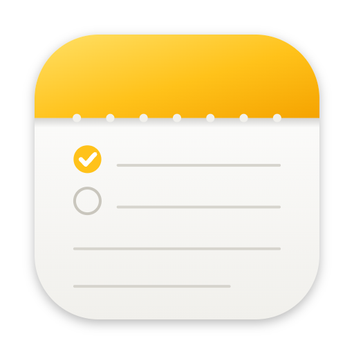
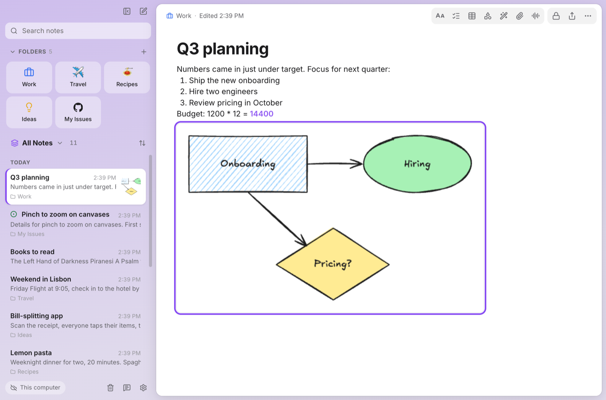
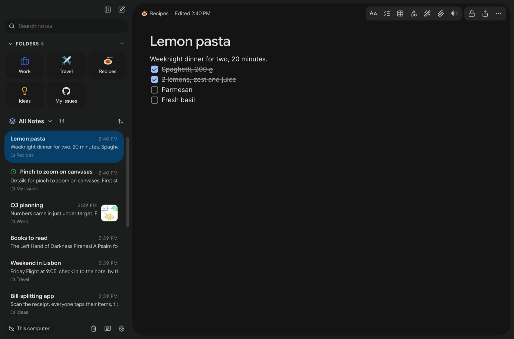
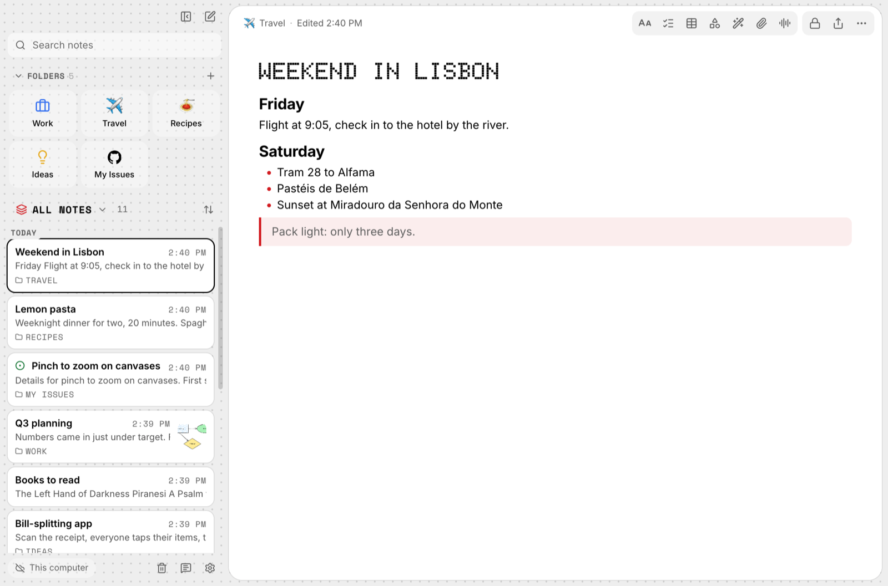
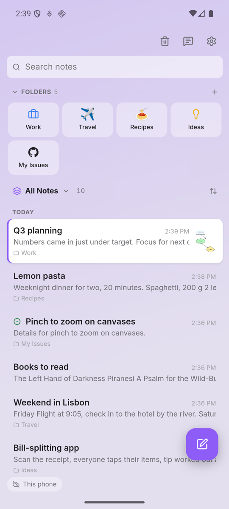
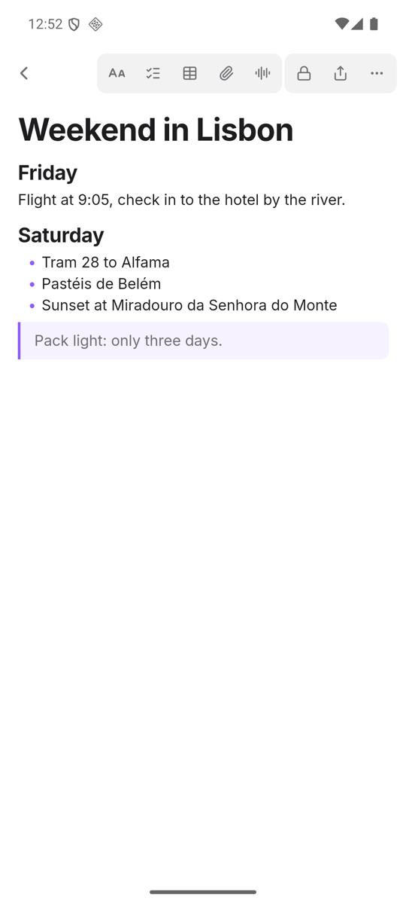
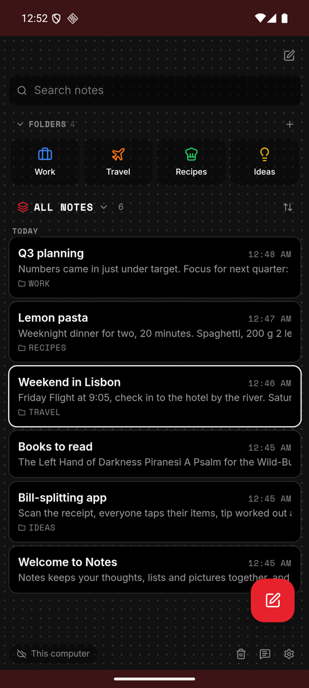
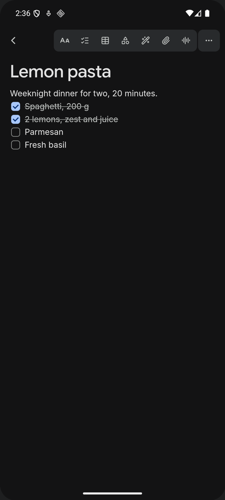
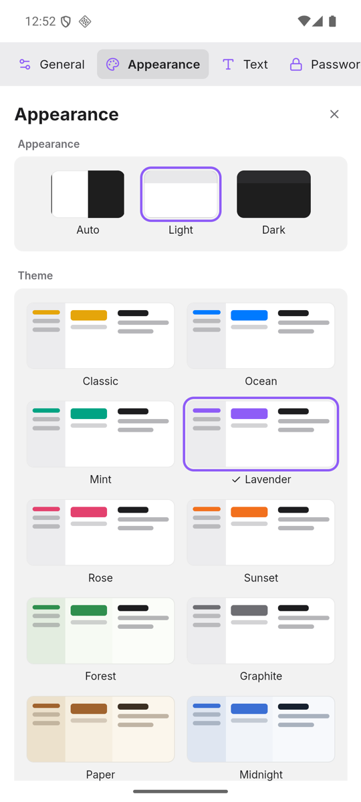

<p align="center"></p>

# Delta Notes

Delta Notes is a notes app with an Arc-inspired look, for **macOS**, **Windows** and **Android** (Android is an early version): folders and tags, checklists and tables, sketches and recordings, locked notes, Math Notes, twelve colour themes, Sync with Google, and importing from the other notes apps.

**[Download the latest release](https://github.com/Deli5150/notes/releases/latest)** · [Website](https://deli5150.github.io/notes/) · [Report a bug or request a feature](https://github.com/Deli5150/notes/issues/new/choose)

## Screenshots

### Mac and Windows

<p align="center"></p>

<p align="center">
  
  
</p>

### Android

<p align="center">
  
  
  
  
  
</p>

## Features

- **Organise** — folders as pinned tiles with icons and colours (like Arc’s pinned tabs), nested folders, Smart Folders (by tags, dates, checklists, attachments, locked, pinned, Quick Notes, folders), #tags in the sidebar, pinned notes, Quick Notes (a floating Quick Note above every app with ⌃⌘N, Ctrl+Alt+N on Windows), Recently Deleted for 30 days, drag notes and folders around.
- **Connected Services** — Smart Folders that fill themselves from GitHub (issues and pull requests), Todoist, Linear, Jira and Google Tasks: each item a note with its open/completed status, and Clear Completed to tidy up.
- **Canvas** — an Excalidraw canvas inside any note: shapes, arrows, lines, freehand drawing, text, pictures, frames, styles and layers, with its tools in the toolbar. Import `.excalidraw` files too.
- **Image Wand** — make a picture from a description (or the note itself), or turn a canvas or sketch into a finished picture, with Google Gemini and your own API key.
- **Titles** — every note has a title field; leave it empty and ✨ Generate title reads the whole note and suggests one (with Apple Intelligence on the Mac, on-device; or with Claude using your own Anthropic API key; or a basic title from the note’s main words).
- **Write** — Title, Heading, Subheading, Body, Monostyled; bulleted, dashed and numbered lists; checklists (checked items can sink to the bottom); block quotes; tables; bold, italic, underline, strikethrough, super/subscript; highlights in Purple, Pink, Orange, Mint and Blue; text colours; any font on your computer, plus bundled ones; sizes, alignment, indentation; collapsible sections; Lines & Grids; links to other notes (type `>>`); find & replace; spelling.
- **Attach** — pictures (paste, drop or pick), scanned documents and photos from your camera, sketches (pen, marker, pencil, eraser; ink follows light/dark), audio recordings, videos, PDFs with a preview, any file, and link previews.
- **Math Notes** — type `rent = 1200` then `rent * 12 =` and the answer appears (Tab to insert, or have it inserted automatically).
- **Lock** notes with one password (AES-GCM encrypted; Touch ID on Macs).
- **View** as a list grouped by date or as a gallery; sort by date edited, created or title; search everything; the Attachments Browser.
- **Sync with Google** — your notes and attachments in a private Google Drive app folder only Notes can see. Notes edited on two devices between syncs keep both versions.
- **Import** from Apple Notes (straight from the Notes app on a Mac), Samsung Notes (.sdocx, or Word/PDF/text exports), Notion (Markdown or HTML export), Evernote (.enex), Google Keep (Takeout), Bear, Simplenote, Standard Notes, Obsidian and any Markdown, plus Word, PDF, text and HTML.
- **Export** a note as PDF, Markdown, HTML or text, print it, export everything as Markdown, or make a full backup.
- **Themes** — Classic, Ocean, Mint, Lavender, Rose, Sunset, Forest, Graphite, Paper, Midnight, Cherry Blossom and Nord, each in light and dark; a see-through sidebar on macOS and Windows 11.
- **Updates** in the app, and **feedback** straight to GitHub issues.

## Building

```sh
npm install
(cd desktop && npm install)
npm run dev            # live-reloading desktop app with its own data (.dev-data/)
npm run typecheck && npm test
npm run dist:desktop   # dist/Notes-<version>.dmg, -mac.zip, Notes-Setup-<version>.exe
npm run android        # dist/Notes-<version>.apk, signed (needs the Android SDK and Java 21)
npm run android:install  # …and installs it on the connected phone or emulator
npm run release        # publishes a GitHub release with those files and the CHANGELOG section
```

The app is a React + [TipTap](https://tiptap.dev) web build (`src/`, built with Vite into `desktop/web`) inside an Electron shell (`desktop/`). See [AGENTS.md](AGENTS.md) for how it fits together.

### Sync with Google

Sync needs an OAuth client from a Google Cloud project with the Drive API on: a **Desktop app** client, with the `drive.appdata` scope. Put it in `.env`:

```
NOTES_GOOGLE_CLIENT_ID=…apps.googleusercontent.com
NOTES_GOOGLE_CLIENT_SECRET=…
```

`scripts/desktop.mjs` writes it into the build (`desktop/google.json`).

## License

MIT.
